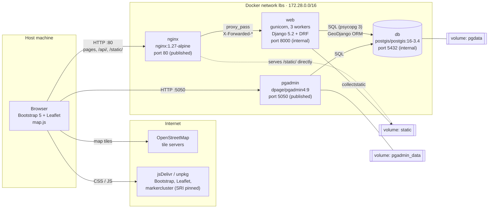
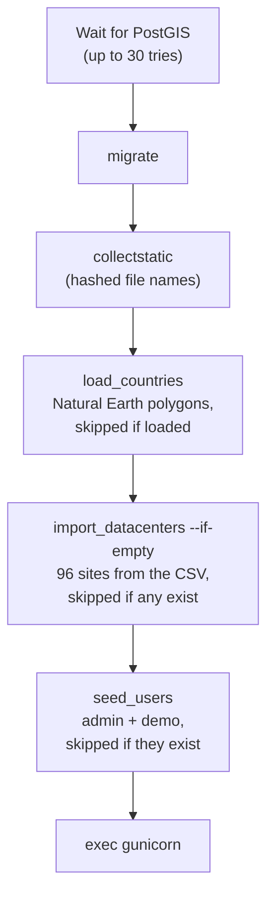
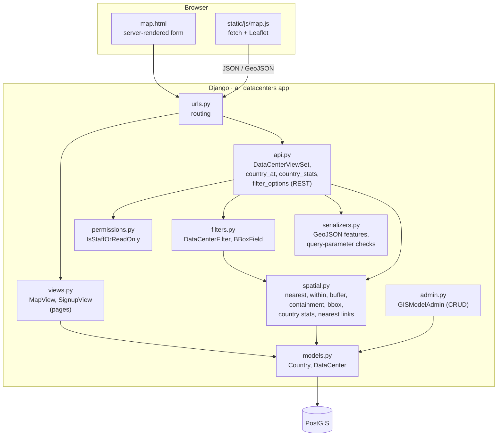

# Architecture

The app runs as four Docker containers on one private network. Nginx is the
only entry point for the web app; Django, gunicorn and PostGIS are not
reachable from the host.

## Components and network

| Container | Image | Host port | Role |
|---|---|---|---|
| `nginx` | `nginx:1.27-alpine` | 80 | Reverse proxy. Serves `/static/` from the shared volume (cached 7 days, gzip), proxies everything else to gunicorn, sets security headers, hides its version. |
| `web` | built from `Dockerfile` (python:3.12-slim + GDAL/GEOS/PROJ) | none (`expose 8000`) | Django app under gunicorn, running as the non-root user `app`. |
| `db` | `postgis/postgis:16-3.4` | none | PostgreSQL 16 with PostGIS 3.4. Healthcheck with `pg_isready`. |
| `pgadmin` | `dpage/pgadmin4:9` | 5050 | Database admin UI. The server "AI Data Center Map DB" is pre-registered by `pgadmin/servers.json`. |

Start order: `db` becomes healthy, then `web` and `pgadmin` start, then
`nginx`. Nginx has its own healthcheck that fetches the login page through
the whole chain.

Volumes keep data across restarts: `pgdata` (database), `pgadmin_data`
(pgAdmin settings), `static` (files written by `collectstatic`, read by
Nginx).

All settings come from `.env` (see `.env.example`): database credentials,
`DJANGO_SECRET_KEY`, `DJANGO_DEBUG`, allowed hosts, CSRF origins, the pgAdmin
login and the two test-account passwords.

## Start-up of the `web` container

`entrypoint.sh` runs these steps, then starts gunicorn. Every step is
idempotent, so a restart never duplicates data.

Geocoding (`geocode_datacenters`) is not part of start-up. It ran once
during development against Nominatim, and its output
`data/datacenters_geocoded.csv` is committed, so start-up needs no network
access to a geocoder.

## Code layers (MVC)

| MVC role | Django files |
|---|---|
| Model | `models.py` (fields, validators, `save()`/`delete()` that keep the derived country and nearest-site line correct), `spatial.py` (the spatial queries) |
| View (presentation) | `templates/` (HTML), `serializers.py` (GeoJSON representation), `static/` (CSS, JS) |
| Controller | `views.py` (pages), `api.py` (REST endpoints), `urls.py` (routing), `filters.py` and `permissions.py` |

## Security

| Area | Measure |
|---|---|
| Exposure | Only Nginx (80) and pgAdmin (5050) are published. Django and PostGIS are reachable only on the `lbs` network. |
| Secrets | All in `.env`, which is git-ignored. `.env.example` holds placeholders only. pgAdmin's `servers.json` stores no password. |
| Django | `DEBUG=False` by default, explicit `ALLOWED_HOSTS` and `CSRF_TRUSTED_ORIGINS`, `HttpOnly` + `SameSite=Lax` cookies, CSRF on every form and on API writes, password validators on sign-up. |
| API | Every endpoint needs a login. Both methods are enabled: the session cookie (browser) and `Authorization: Token` (API clients). Only staff can create, edit or delete. Query parameters are validated (400 with field errors). Text from the data is inserted with `textContent` in the browser, never as HTML. |
| Headers | `X-Content-Type-Options: nosniff`, `X-Frame-Options: DENY`, `Referrer-Policy: strict-origin-when-cross-origin`, `server_tokens off`. |
| Containers | gunicorn runs as an unprivileged user; request bodies are capped at 2 MB. |
| Front-end assets | CDN files are pinned to exact versions with Subresource Integrity hashes. |
