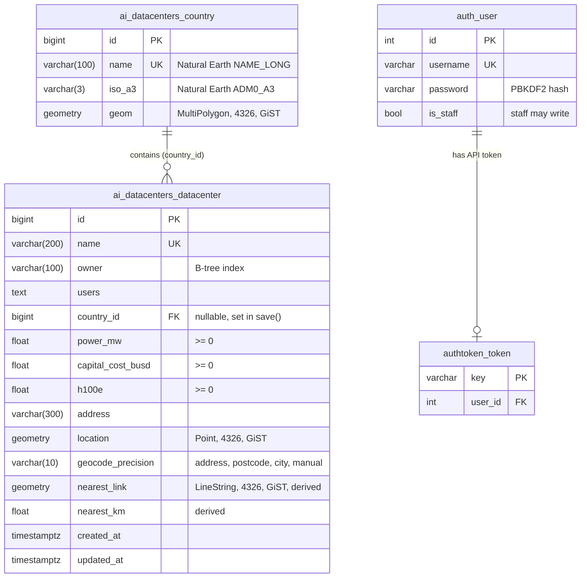

# Database schema

PostgreSQL 16 with PostGIS 3.4. The schema is created by the Django
migrations in `ai_datacenters/migrations/` (`0001_initial`,
`0002_datacenter_h100e`). Every geometry is stored as `geometry` with SRID
4326 (longitude/latitude on WGS 84). Distances are measured on the
ellipsoid at query time, so they are true ground distances in metres.

## Entity-relationship diagram

`auth_user` and `authtoken_token` are Django's own tables (`django.contrib.auth`
and DRF's `rest_framework.authtoken`). `is_staff` decides who may create,
edit and delete data centers.

## Geometry types

| Type | Column | Stored or computed | Used for |
|---|---|---|---|
| Point | `datacenter.location` | Stored | Site position: markers, every distance query |
| LineString | `datacenter.nearest_link` | Stored (derived) | Line to the closest other site ("Cluster links" layer) |
| LineString | `link` in nearest results | Computed per request | Dashed line from the chosen point to each nearest site |
| MultiPolygon | `country.geom` | Stored | Containment, the spatial join, the choropleth |
| Polygon | `buffer` in radius results | Computed per request | The search circle drawn on the map |
| Polygon | `?bbox=` envelope | Computed per request | "Only sites in map view" |

## Tables

### `ai_datacenters_country`

Country borders from Natural Earth admin 0, 1:50m (242 rows), loaded by
`load_countries` from `data/countries.geojson`.

| Column | Type | Null | Notes |
|---|---|---|---|
| `id` | `bigint` | no | Primary key |
| `name` | `varchar(100)` | no | Unique. Natural Earth `NAME_LONG`, e.g. "United States" |
| `iso_a3` | `varchar(3)` | no | Natural Earth `ADM0_A3` (its `ISO_A3` is `-99` for some countries, e.g. Norway) |
| `geom` | `geometry(MultiPolygon, 4326)` | no | Border; single polygons are stored as one-part multipolygons |

### `ai_datacenters_datacenter`

96 AI data centers from the Epoch AI dataset, loaded by `import_datacenters`
from `data/datacenters_geocoded.csv`. Admin and API edits change this table.

| Column | Type | Null | Notes |
|---|---|---|---|
| `id` | `bigint` | no | Primary key |
| `name` | `varchar(200)` | no | Unique. The importer updates by name, so a second import changes nothing |
| `owner` | `varchar(100)` | no | B-tree index (filtered on often). Empty owners become "Unknown" |
| `users` | `text` | no | Comma-separated organisations using the site; may be empty |
| `country_id` | `bigint` | yes | FK to `country`, `ON DELETE SET NULL`. Set in `DataCenter.save()` from the polygon that contains `location`, so it always matches the point. Read-only in the admin |
| `power_mw` | `double precision` | no | IT power in MW, validated `>= 0`. 0 = not yet operational |
| `capital_cost_busd` | `double precision` | no | Capital cost, billions of 2025 US dollars, `>= 0` |
| `h100e` | `double precision` | no | Computing power in Nvidia H100 equivalents, `>= 0`, default 0 |
| `address` | `varchar(300)` | no | Address as given by Epoch AI; may be empty |
| `location` | `geometry(Point, 4326)` | no | Validated: longitude within ±180, latitude within ±90 |
| `geocode_precision` | `varchar(10)` | no | How the point was found: `address` (51), `postcode` (1), `city` (27), `manual` (17) |
| `nearest_link` | `geometry(LineString, 4326)` | yes | Line from this site to the closest other site. NULL when it is the only site |
| `nearest_km` | `double precision` | yes | Length of `nearest_link` in km on the WGS 84 ellipsoid |
| `created_at`, `updated_at` | `timestamptz` | no | Set by Django |

**Derived columns.** `nearest_link` and `nearest_km` are rewritten for every
site by `spatial.recompute_nearest_links()` after each `save()` and
`delete()`, because moving or removing one site can change another site's
nearest neighbour. The admin's bulk "Delete selected" skips the model's
`delete()`, so `DataCenterAdmin.delete_queryset()` calls the recompute too.
The recompute writes with `QuerySet.update()`, which does not call `save()`,
so it cannot recurse.

**Validation.** Model validators (`MinValueValidator(0)`, the coordinate
range in `clean()`) apply in the admin. The API serializer repeats the
coordinate check, and DRF applies the model validators, so bad values return
400 instead of being stored.

## Indexes

Django creates a GiST index on every geometry column. PostGIS adds a
bounding-box test (`@`, `~`) to `ST_Within` and `ST_Contains`, and the GiST
index answers that test, so these queries use it:

- **Radius search**: first the boxes around the search circle
  (`ST_Within(location, box)`, via the index), then the exact ellipsoid
  distance (`ST_DistanceSpheroid`) only for the sites inside the boxes. The
  box comes from the buffer circle drawn 0.1% larger, and is split in two
  when the circle crosses the date line, so no site inside the radius is
  missed. Checked against the distance-only query on 1,224 searches
  (random points, the date line, both poles; 50–5000 km): identical results.
- **Bounding box, containment and the spatial join**: `ST_Within` /
  `ST_Contains`.
- **KNN** `ORDER BY location <-> point` (query 1 in the SQL file).

Two queries do not use it:

- **Nearest neighbours** orders every site by `ST_DistanceSpheroid`. The
  index-backed `<->` measures in degrees, which gives the wrong order far
  from the equator (a degree of longitude shrinks towards the poles). With
  96 rows the exact sort takes a few milliseconds.
- **`ST_DWithin(location::geography, ...)`**: the cast to `geography`
  hides the column from the `geometry` index. An index on the expression
  `(location::geography)` would be needed; the app avoids this query.

On a table this small PostgreSQL often prefers a sequential scan even when
an index fits. Run `SET enable_seqscan = off;` before `EXPLAIN` to see the
index plan.

| Table | Index | Type | Column |
|---|---|---|---|
| `datacenter` | `ai_datacenters_datacenter_location_1759fc8e_id` | GiST | `location` |
| `datacenter` | `ai_datacenters_datacenter_nearest_link_1de433d2_id` | GiST | `nearest_link` |
| `country` | `ai_datacenters_country_geom_24ba1279_id` | GiST | `geom` |
| `datacenter` | `ai_datacenters_datacenter_owner_322ec9a3` (+ `_like`) | B-tree | `owner` |
| `datacenter` | `ai_datacenters_datacenter_country_id_dada1e5c` | B-tree | `country_id` |
| `datacenter` | `ai_datacenters_datacenter_name_key` | unique B-tree | `name` |
| `country` | `ai_datacenters_country_name_key` | unique B-tree | `name` |

List them in pgAdmin with the first query in
[`sql/spatial_queries.sql`](sql/spatial_queries.sql). `EXPLAIN` on the
bounding-box query there shows a `Bitmap Index Scan` on the `location`
index.

## Spatial queries

The app writes every query with the GeoDjango ORM (`ai_datacenters/spatial.py`).
[`sql/spatial_queries.sql`](sql/spatial_queries.sql) has the same queries
as plain SQL to run in pgAdmin.

| Query | Function | Endpoint | PostGIS |
|---|---|---|---|
| Nearest neighbours | `nearest_datacenters(point, n)` | `GET /api/datacenters/nearest/` | `ORDER BY ST_DistanceSpheroid ... LIMIT n`; a line from the point to each result |
| Radius search | `datacenters_within(point, km)` | `GET /api/datacenters/within/` | `ST_Within(location, box)` (index), then `ST_DistanceSpheroid(location, point) <= km × 1000` |
| Buffer | `buffer_polygon(point, km)` | `GET /api/datacenters/within/` | Circle in metres in an azimuthal equidistant projection (`ST_Transform` equivalent via GDAL), back to 4326 |
| Containment (point in country) | `country_at(point)` | `GET /api/countries/at/` | `ST_Contains(geom, point)` |
| Containment (sites in country) | `datacenters_in(country)` | `GET /api/countries/at/` | `ST_Within(location, geom)` |
| Spatial join + aggregate | `country_stats()` | `GET /api/countries/stats/` | Per-country subquery on `ST_Within`, `COUNT` / `SUM` |
| Bounding box | `in_bbox(queryset, bbox)` | `GET /api/datacenters/?bbox=` | `ST_Within(location, envelope)` |
| Nearest other site (stored lines) | `recompute_nearest_links()` | after every save/delete | `ST_DistanceSpheroid` order, `ST_MakeLine`, `UPDATE` |
